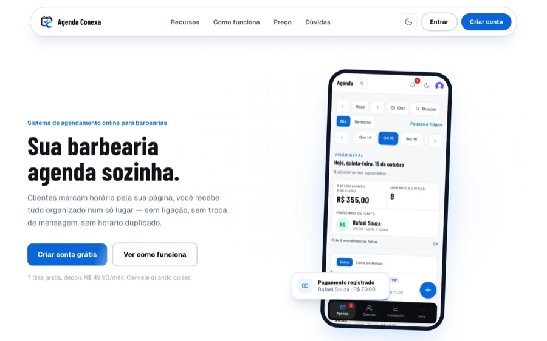
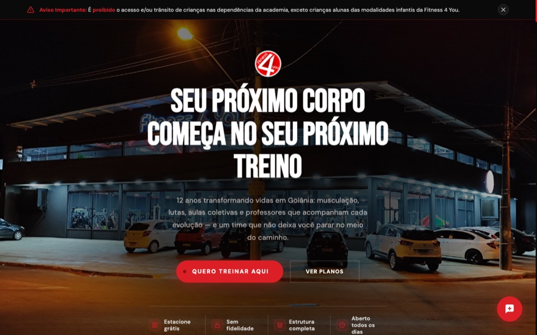

<div align="center">
  
</div>

<div align="center">
  <a href="https://git.io/typing-svg"></a>
  <br/><br/>
  <a href="https://www.linkedin.com/in/gabrielsolera"></a>
  <a href="mailto:gabrielsolera00@gmail.com"></a>
  
</div>

<br/>


## 🚀 Projetos em destaque

<table>
  <tr>
    <td width="50%" valign="top">
      <a href="https://app-barber-flow-winb.vercel.app"></a>
      <h3>✂️ Agenda Conexa</h3>
      <p>SaaS de gestão para barbearias: agendamento online 24h, equipe e comissões, caixa, relatórios e assinatura mensal, com LGPD.</p>
      
      
      
      
      
      <br/><br/>
      <a href="https://app-barber-flow-winb.vercel.app"><b>Ver ao vivo →</b></a>
    </td>
    <td width="50%" valign="top">
      <a href="https://www.fitness4you.app.br/"></a>
      <h3>🏋️ Fitness 4 You</h3>
      <p>Site de uma academia em Goiânia com 12 anos de história, em produção. Feito para converter visitas em matrículas e ser encontrado no Google.</p>
      
      
      
      <br/><br/>
      <a href="https://www.fitness4you.app.br/"><b>Ver ao vivo →</b></a>
    </td>
  </tr>
</table>

<sub>Os repositórios desses projetos são privados. Os links levam às versões publicadas.</sub>


## 🛠️ Tecnologias

<div align="center">
  <br/>
  
</div>

<br/>

```ts
const focoAtual = {
  automacao: ["n8n", "Firecrawl"],
  infra: ["Docker", "servidores self-hosted"],
  faculdade: ["Estruturas de Dados em C", "Arquitetura de Computadores", "Cálculo"],
};
```


## 📊 GitHub

<div align="center">
  
  
  <br/>
  
</div>

<br/>

<picture>
  <source media="(prefers-color-scheme: dark)" srcset="https://raw.githubusercontent.com/Gabriel-Grassmann/Gabriel-Grassmann/output/github-snake-blue.svg" />
  <source media="(prefers-color-scheme: light)" srcset="https://raw.githubusercontent.com/Gabriel-Grassmann/Gabriel-Grassmann/output/github-contribution-grid-snake.svg" />
  
</picture>

<p align="center"><sub><i>"Hardware é o que você chuta, software é o que você xinga, mas a Ciência da Computação é o que explica por que os dois funcionam."</i></sub></p>
